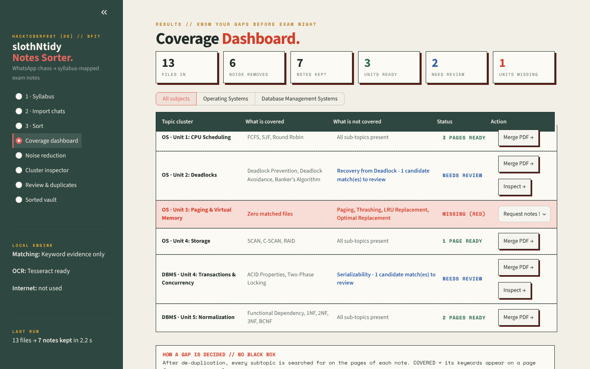
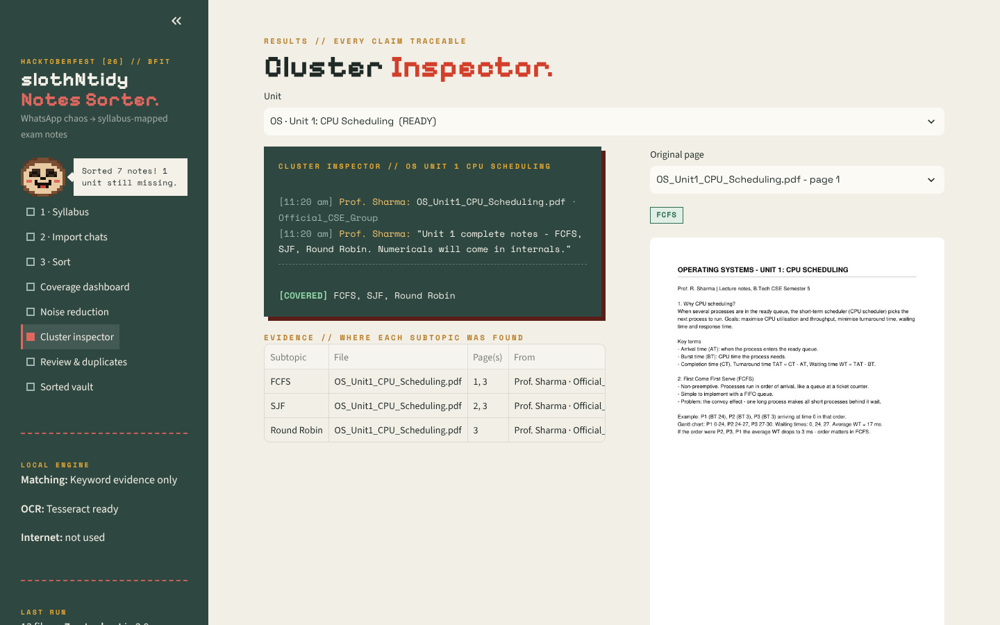
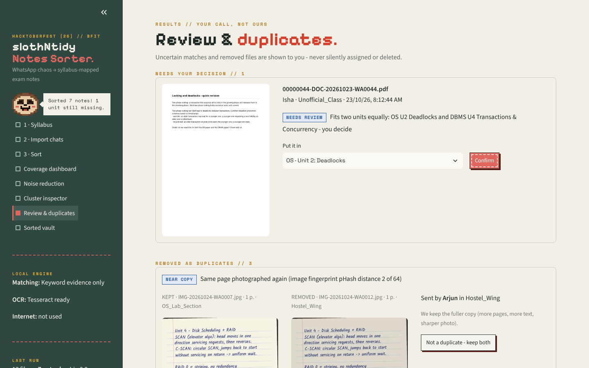

# slothNtidy — Notes Sorter

**From WhatsApp chaos to syllabus-mapped exam notes — sorted by unit, de-duplicated, and traced back to the original page.**
100% local: no cloud, no API keys, works offline.

*Team CodeCrafters · Hacktoberfest [26] // Hack Day Dehradun × BFIT Dehradun*



---

## The problem

Before every internal exam, notes arrive across 4–5 WhatsApp groups: teachers' PDFs, friends' re-shares, photos of handwritten pages, fee circulars and memes, all with names like `DOC-2026-WA0041.pdf`. We timed one run: gathering a single OS unit's notes took **~45 minutes** of scrolling, renaming and re-downloading — before studying even started. Worse, you only find the missing topic at 2 AM.

## What slothNtidy does

You photograph your syllabus (or type it) once, drop in the WhatsApp exports, and press **Sort my notes**:

| Stage | What happens |
|---|---|
| 01 Import | Finds chat exports (`.zip` or `.txt`), PDFs and photos — any number of groups |
| 02 Parse | Pairs every file with its **sender, time, group and caption**; reads text with PyMuPDF, photos and scans with **Tesseract OCR** |
| 03 Clean | Drops circulars & notices, exact copies (**SHA-256**) and near-copies (text similarity + **pHash** for re-photographed pages) — keeping the *fuller* copy |
| 04 Match | Maps each note to a syllabus unit and ticks off subtopics **with the page they were found on** |
| 05 File | Copies everything into `output/SlothVault/<Subject>/<Unit>/` with clean names like `OS_U2_Deadlocks_Rohan_21Oct.pdf` |
| 06 Export | One exam-ready PDF per unit: a coverage cover page + the **original pages, unchanged** |
| 07 Report | The coverage dashboard: every unit **READY**, **NEEDS REVIEW** or **MISSING** |

Nothing is ever deleted: removed files are copied to `_Removed/`, and you can bring any of them back from the app.

| Cluster inspector | Review & duplicates |
|---|---|
|  |  |

---

## Quick start

### Windows (tested target: ThinkPad, 16 GB RAM, no GPU needed)
1. Download this repo: green **Code** button → **Download ZIP** → right-click the zip → **Extract All**.
2. Open the extracted folder and double-click **`setup.bat`** (one time, needs internet, 5–10 minutes).
   It installs Python libraries, downloads the MiniLM model (~90 MB) and Tesseract OCR, then runs the self-check.
3. Double-click **`run.bat`**. The app opens in your browser at `http://localhost:8501`.

### Mac / Linux
```bash
./setup.sh      # one time
./run.sh        # every time
```

### Command line (no UI)
```bash
python main.py             # sort whatever is in ./inbox, using my_syllabus.json
```

---

## How to use it

The app starts empty: no sample syllabus and no sample chats.

1. On **1 · Syllabus**, open **Read my syllabus from a photo, PDF or Word file**, upload a clear photo of each syllabus page (or the PDF / .docx from your college) and press **Read**. The table fills in as a *draft*: check it (a photo can misread a letter), then **Save syllabus**. You can also type or edit rows by hand. It is saved to `my_syllabus.json`.
2. In WhatsApp, open a group → **⋮ → More → Export chat → Include media** (iPhone: group name → **Export Chat → Attach Media**). Get the `.zip` onto your laptop, open **2 · Import chats**, and drop the zips in. Repeat for every group.
3. **3 · Sort** → read your dashboard.

---

## How matching works (no black box)

* **A subtopic is ticked only when its keywords appear on a page** of a note — so every tick links to a page you can open. Captions never tick a subtopic: a caption saying *"recovery skipped"* must not count as covering Recovery.
* **The most evidence wins the unit.** If a note has equal evidence for two units (e.g. *two-phase locking* + *deadlock prevention* → DBMS or OS?), it goes to **Needs review** and you decide — never guessed.
* **MiniLM (all-MiniLM-L6-v2, local)** turns text into meaning-vectors. It ranks units and rescues notes whose keywords OCR could not read — but those are only *suggested* for your review.
* No generative AI, no summaries, no text sent anywhere. If no AI model is installed, keyword matching still works on its own.

| Status | Meaning |
|---|---|
| READY | every subtopic found on at least one page |
| NEEDS REVIEW | some subtopics still missing, or a note fits two units |
| MISSING | no note covers this unit at all — ask your class (the app writes the message for you) |

*Coverage means "covered in the notes you received" — it is not a guarantee of exam completeness.*

## Reading handwriting with Gemma 4

Tesseract reads printed text but not handwriting, so handwritten notes used to wait in *Needs review*. **Gemma 4**, Google's open-weight multimodal model, now reads those pages from their images.

* **Gemma only reads; it never decides.** Its transcript goes through the same keyword matching as every other page, so each tick is still traceable to a page, and the Cluster Inspector shows the page image next to Gemma's transcript.
* **Only pages Tesseract cannot read go to Gemma**: too little text, or mostly garbage. That's at most 2 per file (`MAX_GEMMA_PAGES`). Typed PDFs never go to Gemma.
* **It can never break a sort.** Answers are cached in `.gemma_cache/`, so a second run is instant and works offline. Each page gets a timeout and one retry, and Gemma switches itself off after 3 failures in a row, leaving Tesseract's text in place.

**You never choose which reader reads which page** - the program decides page by page: typed PDF text is read directly, printed scans go to Tesseract, and pages Tesseract cannot read go to Gemma 4. Paste a free Gemini API key once in **3 · Sort**; it is saved on the laptop in `.gemini_key` (git-ignored) and Gemma switches on by itself. To run Gemma locally instead, set `GEMMA_BACKEND = "local"` in `config.py`.

| | Google Gemini API | On this laptop (Ollama) |
|---|---|---|
| Model | `gemma-4-26b-a4b-it` | `gemma4:e4b` |
| Needs | free API key from [aistudio.google.com](https://aistudio.google.com) | one-time download: `ollama pull gemma4:e4b` |
| Privacy | the handwritten page images are sent to Google | nothing leaves the laptop |
| Speed | a few seconds per page | slow without a graphics card |

The key can also come from the `GEMINI_API_KEY` environment variable. It is never committed to GitHub.

## AI models used (and their licenses)

| Model | What it does here | License / terms |
|---|---|---|
| [Gemma 4](https://ai.google.dev/gemma) (`gemma-4-26b-a4b-it` on the Gemini API, `gemma4:e4b` on Ollama) | reads handwritten pages | [Apache 2.0](https://www.apache.org/licenses/LICENSE-2.0) |
| [all-MiniLM-L6-v2](https://huggingface.co/sentence-transformers/all-MiniLM-L6-v2) | ranks syllabus units by meaning (local) | Apache 2.0 |
| [Tesseract OCR](https://github.com/tesseract-ocr/tesseract) | reads printed scans and photos (local) | Apache 2.0 |
| [nomic-embed-text](https://ollama.com/library/nomic-embed-text) (optional) | alternative local embeddings via Ollama | Apache 2.0 |

## Privacy

WhatsApp exports contain classmates' names and phone numbers. slothNtidy processes everything on your laptop. The one exception is when you switch on Gemma 4 with the Gemini API: then only the handwritten page images Tesseract could not read are sent to Google. Choose *On this laptop* to keep even those local. `inbox/`, `output/` and `my_syllabus.json` are git-ignored — **never commit a real chat export**.

---

## Project structure

```
app.py            the UI (Streamlit)              main.py        command-line runner
pipeline.py       runs all 7 stages + your review decisions
gemma.py          Gemma 4 handwriting reader (Gemini API or local Ollama), with cache and fallbacks
parser.py         WhatsApp chat parsing (Android, iPhone, short format) + PDF/photo reading + OCR
filters.py        circulars, SHA-256 exact copies, text/pHash near-copies (keeps the fuller copy)
matcher.py        keyword evidence per page + MiniLM unit ranking -> sorted / needs-review / unmatched
embedder.py       local embeddings: MiniLM, or Ollama nomic-embed-text, or none
filing.py         copies notes into SlothVault with clean names
exporter.py       one merged PDF per unit (cover page + original pages, bookmarks)
report.py         COVERAGE.md + report.json
syllabus.py       syllabus load/save         config.py      every folder and threshold
syllabus_reader.py  syllabus photo / PDF / Word -> units and subtopics (Tesseract OCR + layout rules, draft only)
tests/            pytest suite (no internet needed); tests/demo_data holds the made-up groups the tests use
scripts/make_demo_data.py   regenerates tests/demo_data
```

Outputs land in `output/`: `SlothVault/` (sorted copies), `TopicPDFs/` (merged PDFs), `COVERAGE.md`, `report.json`.

## Tests
```bash
python -m pytest -q
```
Covers caption pairing on real Android/iPhone exports (including WhatsApp's invisible U+200E mark), circular filtering, exact and near duplicates, subtopic evidence, ambiguous notes, a full end-to-end run on made-up class groups, and reading a syllabus from text, a Word table, a PDF and a phone photo.

## Known limits & roadmap
* **Handwriting:** read by Gemma 4 when switched on (see above). Gemma can misread very messy pages. Every transcript can be checked next to the original page in the Cluster Inspector. Without Gemma, handwriting lands in *Needs review* (flagged, never lost).
* `.docx` / `.pptx` attachments are listed but not read yet.
* Keywords are per-subtopic; a syllabus read from a photo gets keywords only for short forms like *Shortest Job First (SJF)*. Long subtopic names work better with a few short keywords added by hand.
* The syllabus reader understands "UNIT I" headings and Unit / Topic tables; unusual layouts may need more correction in the table.

## Earlier tools in this repo
`Tidy.py` (LLM-based PDF tidier) and `sloth.py` (offline Git commit helper via Ollama) are the team's earlier experiments and are not part of the notes-sorter pipeline. `engine.py` is their Ollama client.

## License
MIT — see [LICENSE](LICENSE).
